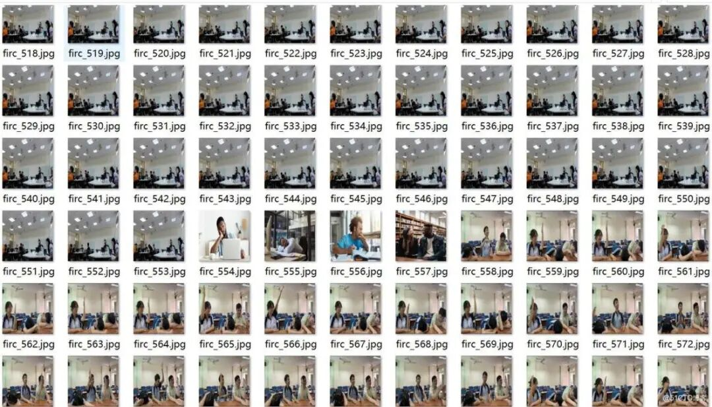
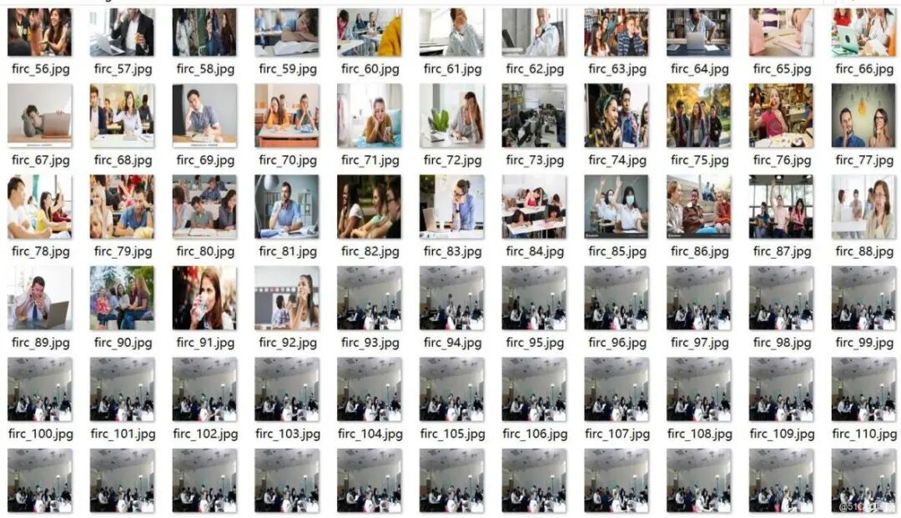
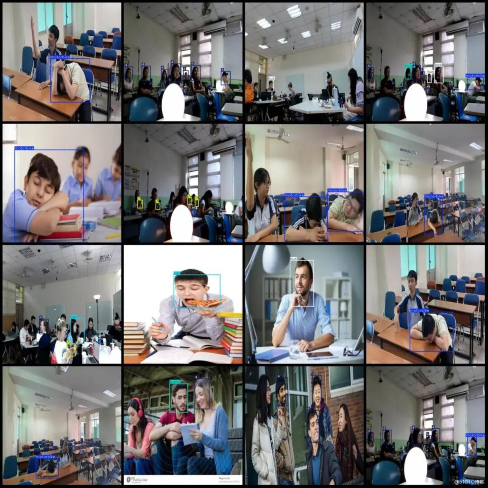

# Student Classroom Behavior Detection System Based on Yolov11+Django+DeepSeek with a Login Interface in Python Source Code + ONNX Model + Beautiful Web Interface

Effect Display: Login interface main interface based on YOLO11 target detection system, supports image, video and real-time camera detection, integrated DeepSee.

## Effect Display

Login interface


Main Interface


A target detection system based on YOLO11, supporting image, video, and real-time camera detection, integrated with DeepSeek AI analysis functions.

### Functional Characteristics

-

Image target detection

-

Video file detection

-

Real-time camera detection

-

DeepSeek AI Intelligent Analysis

-

Adjustable detection parameters (confidence, IoU)

-

Beautiful user interface

### [Test Environment]

windows10

anaconda3+python3.10

torch 2.3.1

ultralytics 8.4.7

Django==5.2.11

### Model can detect 8 categories

Drowsy-Sleeping

Eating-Drinking

Focused-Thinking

Looking down

Looking upfront

Raising Hand

Using-Laptop-Writing

Using-Phone

[Training Dataset Introduction]

Dataset format: YOLO format (txt file without split path, only contains jpg images and corresponding YOLO format txt files)

Number of images (number of jpg files): 1277

Number of annotations (number of txt files): 1277

Number of training set: 894

Number of Validation Sets: 258

Number of test sets: 125

Annotation category count: 8

Label category names (note that the order of categories in the YOLO format does not correspond to this, but is based on the labels folder's classes.txt': ['Drowsy-Sleeping', 'Eating-Drinking', 'Focused-Thinking', 'Looking down', 'Looking upfront', 'Raising Hand', 'Using-Laptop-Writing', 'Using-Phone']

Number of boxes labeled in each category:

Drowsy-Sleeping (sleepiness) frame count = 584

Eating-Drinking (Number of meals (including water) = 185

Focused-Thinking (focused-thinking) box count = 343

Looking down (downward) frame count = 375

Looking upfront (look forward) box count = 1058

Raising Hand (raise hand) frame count = 144

Using-Laptop-Writing (using laptop-writing) box = 408

Using-Phone (using phone) frame count = 368

Total frame count = 3465

Using labelImg:

Annotation rules: Draw a rectangle around the category.

Important Notice: No

Special : This dataset does not guarantee the accuracy of the trained models or weight files.

Image Preview:





Annotation example:



[Training Information]

Number of training set images = 939

Number of validation set images = 269

Training map=61.2%

Training accuracy (Precision) = 64.4%

Training recall rate (Recall) = 60.4%

[Verification set accuracy]

Category = Map50 (%)

MAP50 all=61

Drowsy-Sleeping=74

Eating-Drinking=60

Focused-Thinking=51

Looking down=42

Looking upfrnotallow=68

Raising Hand=59

Using-Laptop-Writing=57

Using-Phnotallow=79

### Install Dependencies

```
pip install -r requirements.txt
```

### Database Migration

```
Python manage.py makemigrations
Python manage.py migrate
```

### Running Projects

```
Python manage.py runserver
```

Visit HTTP://127.0.0.1:8000

### Default login information

-

Username: admin

-

Password: admin

### Main File Structure of the Project

```
yolo11-Django-deepseek-det-system/
├── manage.py               # Django management script
├── yolo_detection/ # Project configuration directory
│   ├── __init__.py
├── settings.py # Project settings
├── urls.py # Main URL configuration
└── wsgi.py # WSGI configuration
├── detection/  # Detection Application
│   ├── __init__.py
├── apps.py # Application configuration
├── forms.py
├── models.py
├── urls.py # Application URL configuration
└── views.py # View functions
├── templates/ # Template directory
├── test_img/ # Test image directory
├── index.HTML # Main page
└── login.HTML # Login Page
├── static/  # Static file directory
├── media/  # Media file directory
└── uploads/ # Upload Files Directory
├── requirements.txt  # Dependency list
├── weights/  # Template directory
├── yolov11n.onnx # Model file
└── results.png # Training log image
├── class_names # Model category file
└── MODEL_DESCRIPTION.txt # Training brief and training process map0.5 parameters
```

### Technology Stack

-

Django 4.2+

-

YOLO11 (Ultralytics)

-

OpenCV

-

DeepSeek API

-

Chart.js

-

HTML5/CSS3/JavaScript

### Notes

-

Ensure that the `yolov11n.onnx` model file is in the project's weights directory.

-

DeepSeek API key needs to be configured in `settings.py`

-

Recommend using Python 3.8+

### Common Evaluation Parameters Introduction

In the task of object detection, evaluating the performance of a model is crucial. The terms you mentioned are commonly used metrics for assessing the performance of a model. Here are detailed explanations of these terms:

Class: This usually refers to the category of objects that the model is designed to detect. For example, a model may be trained to detect different categories of objects such as vehicles, pedestrians, or animals.

Images: Represents the number of images in the validation set. The validation set is a dataset used to evaluate model performance, separate from the training set to ensure fairness in evaluation results.

Instances: The total number of target objects in all images. This includes the sum of all categories of objects, for example, if the validation set contains 100 images, each image has an average of 5 target objects, then Instances is 500.

P (Precision): Precision is the ratio of true positives to all instances predicted as positive by the model. The formula is: Precision = TP / (TP + FP), where TP represents True Positives and FP represents False Positives.

mAP50: Mean Average Precision at IoU (Intersection over Union) threshold of 0.5.

IoU is an indicator measuring the degree of overlap between the predicted bounding box and the ground truth bounding box. mAP is a comprehensive metric that considers both precision and recall to evaluate the performance of a model across different recall levels. At IoU=0.5, if the overlap between the predicted bounding box and the ground truth bounding box reaches or exceeds 50%, it is considered correct.

mAP50-95: Refers to the average precision of a model within an IoU range from 0.5 to 0.95 (with a step of 0.05). This is a more stringent evaluation criterion, demanding higher overlap between predicted bounding boxes and true ones. In object detection tasks, a higher IoU threshold means that the model needs to be more accurate in target object localization. The computation of mAP50-95 takes into account multiple IoU thresholds ranging from lenient to strict, thus providing a comprehensive assessment of the model's performance. These metrics collectively form an important framework for evaluating the performance of object detection models. By comparing the performance of different models on these metrics, one can determine which model might be more effective in practical applications.

### Common Issues

In the training of target detection, if the Mean Average Precision (MAP) is low, there may be the following reasons:

Reason 1: Underfitting: If the amount of training data is too small, the model may not learn enough features to affect prediction performance, resulting in underfitting, which in turn causes a lower MAP. Therefore, increasing the size of the dataset can be beneficial.

Reason two: Small targets: If the dataset contains most small targets, there is a possibility of having a low map. Because the small target features are not obvious. The model is difficult to learn features.

Reason 3: Mismatched model tuning parameters: For instance, if the learning rate is adjusted too high, it may lead to an overly rapid learning capability, resulting in disordered adjustments of model parameters.

Reason 4: Overfitting (This is now a rare occurrence in models): If the model performs exceptionally well on training data but poorly on validation or test data, it may be due to overfitting. This is often caused by an excessive number of model parameters relative to the amount of training data available, leading the model to learn noise or specific patterns from the training data and fail to generalize to new data. Nowadays, target detection models are well-equipped to handle this situation, with very few instances of overfitting occurring.

Reason 5: Different scenarios: The validation set has high accuracy. The test set is not suitable. The issue may be due to inconsistencies between the training model scene images and the test map, resulting in a low test map. In response to the above reasons, The following measures can be taken to improve MAP:

(1) Optimize model structure: Select the appropriate model based on the characteristics of the task and dataset, and try using different network architectures and components to improve model performance.

(2) Enhance Data Preprocessing: Proper preprocessing and enhancement of data, such as data normalization, missing value imputation, data expansion, etc., to enhance the generalization capability of the model.

(3) Adjusting the Loss Function: Try using different loss functions or combining multiple loss functions to optimize model performance.

(4) Optimize training strategies: Adjust hyperparameters such as learning rate, batch size, and number of training iterations, and employ optimization algorithms like learning rate decay and momentum to enhance model training effectiveness.

(5) Use pre-trained models: Transfer learning using pre-trained models on large datasets can accelerate model convergence and improve performance. (6) Increase the number of datasets

### Provided documents

Python source code

yolo11n.onnx model (without providing pytorch model)

Trained map, P, R curve plot (in weights\results.png)

Test images (under test_img folder)

Please note that the dataset is provided in the dataset_address.xlsx file.


## Payment

Here is a pay link on Stripe ( https://buy.stripe.com/3cs8yP7sY87d0vu9AB ). Please contact me lonlonago@foxmail.com after funding $89, and I will send you a complete data files , thank you!


